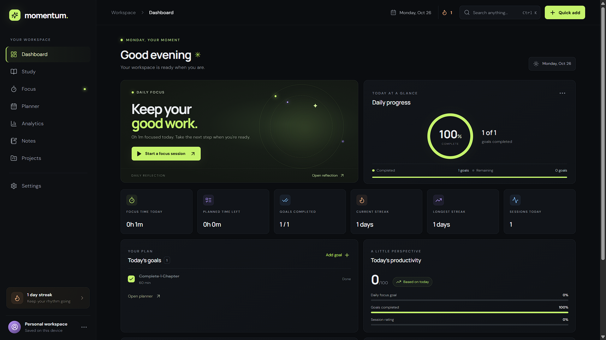

# Momentum

### A personal workspace for focus, study, and the projects you care about.

This project was built through a **vibe-coding workflow with ChatGPT and Codex**: shaping the product, iterating on the interface, and building its features step by step.



---

## 1. About Momentum

Momentum is a browser-based productivity dashboard for people who want one place to organize focused work and see their progress over time. It works without an account. Your workspace is stored locally in your browser, and you can export a backup from Settings.

---

## 2. Features

- **Personal dashboard:** See today's focus time, goals, completed work, sessions, and streaks at a glance.
- **Study tracker:** Create subjects and chapters, set estimated durations, and track completed study time.
- **Focus timer:** Use Pomodoro, stopwatch, or custom timer modes. Link sessions to a subject, chapter, or task, then save a rating and note.
- **Planner:** Add dated events with times and optional subject links.
- **Analytics:** Explore weekly, monthly, or yearly activity, session statistics, subject breakdowns, and a study heatmap. Charts are empty until you record activity.
- **Notes:** Create, edit, pin, tag, search, and organize notes.
- **Projects:** Track project descriptions, deadlines, statuses, and tasks.
- **Daily reflection and check-in:** Record reflections, mood, and energy.
- **Personal settings:** Save your name, switch between light and dark themes, choose an accent color, and adjust focus targets and timer length.
- **Search and quick add:** Find saved workspace items or quickly add new ones. Use `Ctrl+K` or `⌘K` to search.
- **Backup and restore:** Export your workspace as JSON, restore from a backup, or clear local workspace data in Settings.

### Your data

Momentum stores workspace data in **IndexedDB** in your browser. It does not require an account, and data does not sync between browsers or devices. The website cannot recover data after you clear the browser's site storage, so export a backup from Settings if you want a separate copy.

### Try the app

**[Open Momentum](https://momentum-workspace.pages.dev/)** — the public version is ready to use in your browser.

---

## 3. For developers

You can copy the repository, run Momentum locally, and customize it for your own workflow.

### Requirements

- [Node.js](https://nodejs.org/) (includes npm)
- Git

### Clone and run

```bash
git clone https://github.com/vaibhavvraj/momentum.git
cd momentum
npm install
npm run dev
```

Open the local address printed by Vite, usually `http://localhost:5173`.

### Build and preview

```bash
npm run build
npm run preview
```

The production files are generated in `dist/`.

### Tech stack and project structure

- **React + TypeScript** build the application UI.
- **Vite** runs the local development server and creates production builds.
- **Zustand** keeps the current workspace state available to the interface.
- **Dexie + IndexedDB** provide browser persistence.
- **Framer Motion** adds interface transitions.
- **Lucide React** supplies icons; responsive styling is in custom CSS.

The main application is in `src/App.tsx`, shared styles are in `src/styles.css`, and workspace types, persistence, hydration, import, and export are managed in `src/store.ts`. Data is loaded from IndexedDB when the app starts and written through the store as it changes. The persistence logic is kept in the store so it can be adapted to another storage provider later.

To personalize the app, edit the components and styles, then run `npm run dev` to see changes. Browser data is separated by site origin, so a local development workspace is separate from the public site workspace.
